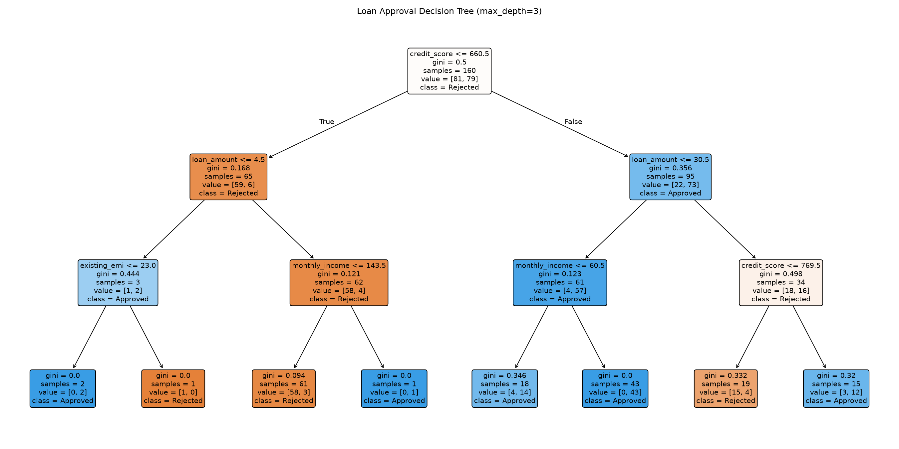
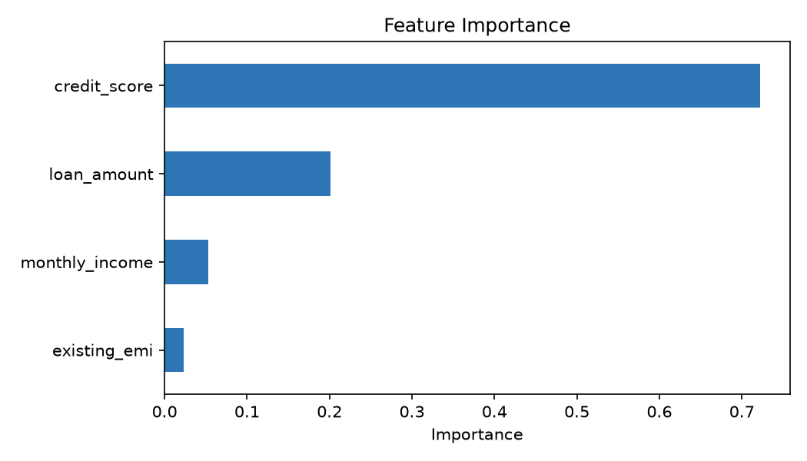

# Loan Approval Prediction using a Decision Tree

Day 3 of my Machine Learning journey. A beginner-friendly classification project that predicts whether a loan application is **approved or rejected**, and shows how tree depth affects overfitting.

> **Note:** The dataset is synthetic (200 records) and was created for learning purposes. Results are educational and must not be used for real lending decisions.

## Project Objective

Predict loan approval from applicant details using a Decision Tree Classifier, and study how `max_depth` affects train vs test performance.

## Dataset

| Feature | Description |
|---|---|
| monthly_income | Monthly income (in thousand rupees) |
| credit_score | Credit score (550 to 850) |
| loan_amount | Requested loan (in lakhs) |
| existing_emi | Existing monthly EMI (in thousand rupees) |
| **approved** | **Target: 1 = Approved, 0 = Rejected** |

File: `loan_data.csv` (200 rows, 99 approved and 101 rejected)

## Workflow

1. Generate the synthetic dataset
2. Separate features (X) and target (y)
3. Split into 80% train / 20% test (stratified)
4. Compare trees of different depths to study overfitting
5. Train the final model (`max_depth=3`, Gini impurity)
6. Evaluate with accuracy, confusion matrix and classification report
7. Inspect feature importance and visualize the tree
8. Predict a new applicant

## Key Results

**Overfitting experiment**

| max_depth | Train Accuracy | Test Accuracy |
|---|---|---|
| 1 | 0.825 | 0.825 |
| 2 | 0.844 | 0.700 |
| 3 | 0.912 | 0.775 |
| 4 | 0.944 | 0.775 |
| 5 | 0.969 | 0.775 |
| 8 | 1.000 | 0.800 |
| None | 1.000 | 0.800 |

An unlimited tree reaches 100% training accuracy by memorizing the data, but test accuracy stays at 80%.

**Final model (`max_depth=3`)**: accuracy 77.5%, recall 0.80 for Rejected and 0.75 for Approved.

**Feature importance**: credit_score 72.2%, loan_amount 20.1%, monthly_income 5.3%, existing_emi 2.3%.




## Limitations

- Small synthetic dataset with only 40 test samples. Each sample is worth 2.5% accuracy, so results are noisy and differences between depths are not statistically meaningful.
- Single train/test split, with no cross-validation yet.

## Next Steps

- [ ] Cross-validation (`cross_val_score`)
- [ ] Hyperparameter tuning (`GridSearchCV`)
- [ ] Real-world dataset
- [ ] Compare with Logistic Regression and Random Forest (Day 4)

## How to Run

```bash
pip install -r requirements.txt
python loan_approval_decision_tree.py
python make_carousel.py   # optional: builds the LinkedIn carousel
```

## Project Structure

```
.
├── loan_approval_decision_tree.py   # data generation, training, evaluation, plots
├── make_carousel.py                 # builds LinkedIn slides from results.json
├── loan_data.csv                    # generated dataset
├── results.json                     # metrics saved by the main script
├── decision_tree.png
├── feature_importance.png
├── requirements.txt
└── README.md
```

## Tech Stack

Python, Pandas, NumPy, Scikit-learn, Matplotlib
